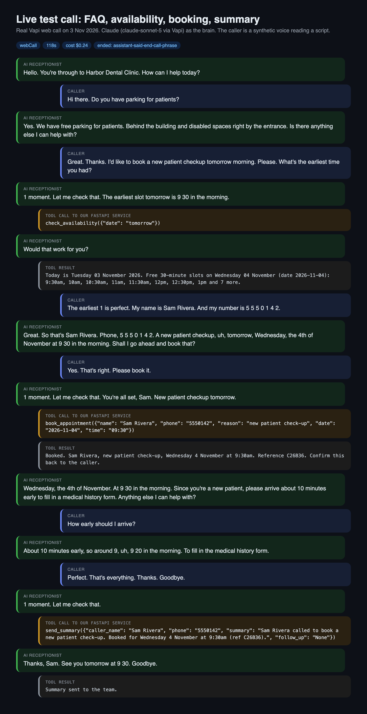
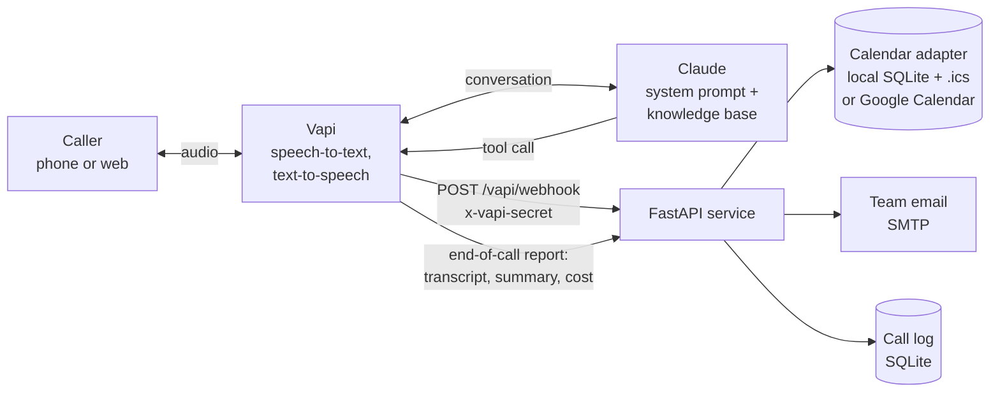
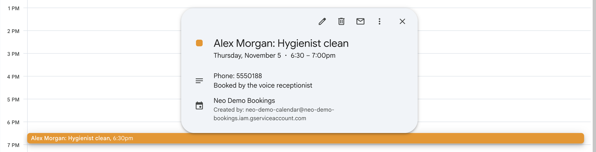
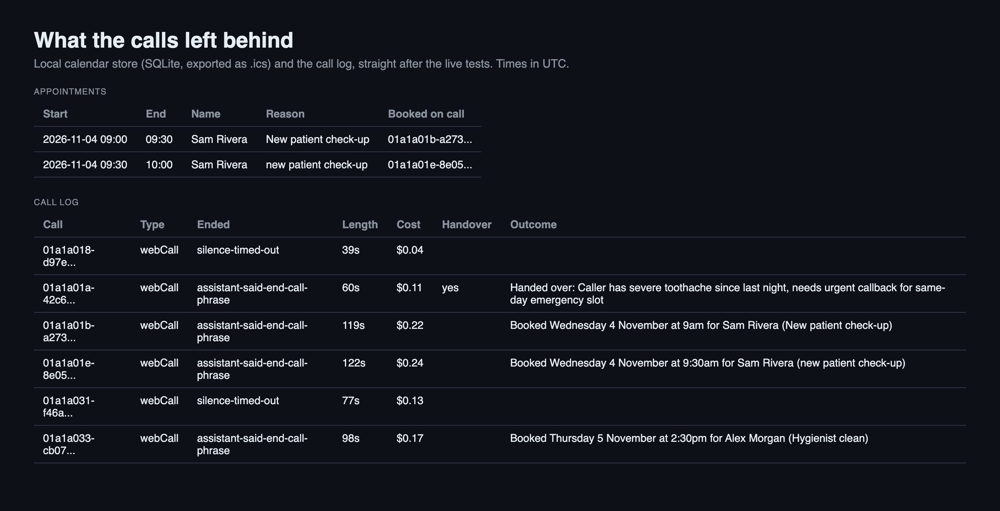

# Voice AI Receptionist

An AI receptionist that talks to callers. It runs on [Vapi](https://vapi.ai) (the voice platform: speech-to-text, the phone line or web call, text-to-speech) with Claude as the brain, and a small FastAPI service that does the real work behind four tools:

- **check_availability**: reads the calendar and offers real free slots, never invented ones
- **book_appointment**: re-checks the slot is still free, then writes the booking into the calendar
- **send_summary**: emails the team a short summary of every call
- **handover**: when a caller asks for a person (or is in pain), alerts the team to call them back, marked urgent when it can't wait

Questions like "do you have parking?" are answered from a small knowledge base. Every call and every tool call is logged.



*A real Vapi web call on 3 November 2026 (full transcript and tool calls as recorded by Vapi). 9am was already taken by an earlier test, so the receptionist offered 9:30, the earliest slot the calendar actually had.*

## How it works



1. Vapi answers the call and streams the caller's speech to Claude. The assistant definition (built by `receptionist/assistant.py`) holds the receptionist rules and the knowledge base from `data/knowledge_base.md`.
2. When Claude needs real data it calls a tool. Vapi posts the tool call to `/vapi/webhook`; the service checks the `x-vapi-secret` header, runs the tool and answers with one short sentence Claude can say out loud.
3. At the end of the call Vapi posts an `end-of-call-report` (transcript, Vapi's own summary, length, cost, why it ended), which goes into the call log next to every tool call made during the call.

## Design choices

- **The calendar is an adapter.** Anything with two methods, `busy(start, end)` and `create_event(booking)`, works as a calendar. Slot logic (opening hours, 30-minute slots, minimum notice, double-booking check) lives in one place, `receptionist/scheduling.py`, so every backend behaves the same.
  - `LocalCalendar`: SQLite plus an `.ics` export at `/calendar.ics` that Google Calendar, Outlook or Apple Calendar can subscribe to. Used for the live tests.
  - `GoogleCalendar`: free/busy and event insert through the Google Calendar REST API with a service account (key from a file or straight from a secret store via `GOOGLE_SERVICE_ACCOUNT_JSON`; needs `pip install google-auth requests`). Unit-tested against mocked HTTP and tested live (see below).
- **Tools answer in plain sentences.** A voice agent has to say the result out loud, so each tool returns something speakable ("Booked. Sam Rivera, new patient check-up, Wednesday 4 November at 9:30am") rather than raw JSON.
- **The whole day, split in two.** For a named day the tool lists every free slot as "Morning: ... Afternoon: ...". An earlier version listed only the first eight, and a live call where the caller asked for "the first time after 2pm" stalled because the afternoon was hidden from Claude.
- **Dates are resolved by the server, not the model.** The caller says "tomorrow" or "Friday"; the tool works out the date in the business's time zone and tells Claude today's date in every result, so the model never has to guess it.
- **Fails out loud, not silent.** If the calendar can't be reached, the tool tells Claude to offer a message and a call-back instead of leaving dead air, and the error is written to the call log.
- **Caller words are data.** Names and reasons are cleaned (control characters stripped, length capped) before they reach a calendar or an email, and the prompt tells Claude to ignore instructions from callers.
- **Tool discipline.** The first live run showed Claude starting to say a time in the same breath as the tool call. The prompt now tells it to call the tool on its own, play a short "One moment, let me check that", and only state times or bookings once the result is back.
- **Handover without a phone line.** `handover` always alerts the team by email with the caller's name, call-back number, reason and urgency. If `TRANSFER_NUMBER` is set, Vapi's built-in `transferCall` tool is added too, so the call can be put straight through.

## Run it

```bash
python -m venv .venv && source .venv/bin/activate
pip install -r requirements.txt -r requirements-dev.txt
cp .env.example .env        # fill in what you need, then load it into your shell

uvicorn receptionist.main:app --port 8765
```

Vapi has to reach the service over HTTPS. For a quick test a free Cloudflare tunnel is enough (no account needed):

```bash
cloudflared tunnel --url http://localhost:8765     # prints https://<random>.trycloudflare.com
```

Create the assistant on Vapi and point a phone number at it:

```bash
python scripts/create_assistant.py --server-url https://<random>.trycloudflare.com \
    --phone-number-id <vapi-phone-number-id>       # optional
python scripts/create_assistant.py --server-url ... --assistant-id <id>   # update later
```

Useful endpoints (all need the `x-vapi-secret` header): `GET /calls` for the call log with tool events, `GET /calendar.ics` for the bookings. `GET /health` is open.

### Test call without a phone

`scripts/web_test_call.py` joins a real Vapi web call from a local headless Chromium. Instead of a microphone it plays pre-recorded caller lines (made with any text-to-speech, for example macOS `say`), waiting for the receptionist to finish speaking before each one. Everything on the Vapi side (speech-to-text, Claude, the tools, text-to-speech) runs exactly as it would on a phone call.

```bash
pip install playwright && playwright install chromium   # only needed for this script
say -o 01.aiff "Hi there. Do you have parking for patients?" && afconvert -f WAVE -d LEI16@48000 01.aiff clips/01.wav
VAPI_PUBLIC_KEY=... python scripts/web_test_call.py --assistant-id <id> --clips clips --shot call.png
VAPI_API_KEY=... python scripts/get_call.py <call-id>      # transcript and tool calls from Vapi's log
```

## Tests

```bash
pytest -v
```

35 tests, no network and no secrets (they also run on GitHub Actions on every push). They cover every tool call (availability for a named day, no day, a bad day, a past day and a closed day; booking, double-booking, outside opening hours, missing details, caller-ID fallback; summary email; handover email and log flag; calendar failure fallback; unknown tool), the webhook end to end (secret check, arguments as JSON object or string, several tool calls in one message, end-of-call report logging, `.ics` export), slot maths, date and time parsing, the local calendar and `.ics` format, the Google Calendar adapter against mocked HTTP, and the assistant definition.

## Tested live

**Tested live on 3 November 2026** on a Vapi account with its free starter credit. The service ran on a Mac behind a Cloudflare quick tunnel; team emails went out over Gmail SMTP to a test inbox. The Google Calendar booking used a real Google Calendar (a dedicated demo calendar shared with a service account); the other two calls used the local SQLite calendar.

| Call | What happened | Length | Vapi cost |
|---|---|---|---|
| Booking | Caller asked about parking (answered from the knowledge base), asked for the earliest slot tomorrow morning, gave name and number, confirmed. `check_availability`, `book_appointment` and `send_summary` all ran; the booking appeared in the calendar store and `.ics` export with the call ID attached; the summary email went out (confirmed in the sending mailbox). | 2m 2s | $0.24 |
| Google Calendar booking | Caller asked the price of a hygienist clean (55 pounds, from the knowledge base), then for the first time after 2pm on Thursday. Free slots came from Google's free/busy API; Claude offered 2:30pm, read it back, and `book_appointment` wrote the event into Google Calendar (checked through the API and in the Calendar web app, then deleted). Summary email went out. | 1m 38s | $0.17 |
| Handover | Caller with toothache asked for a real person. Claude collected name and call-back number, called `handover` with `urgent: true`, told the caller the team would ring back within 15 minutes, then sent the summary. Both emails went out (confirmed in the sending mailbox). | 1m 0s | $0.11 |



*The event the receptionist created, open in Google Calendar. The viewer is on Dubai time (GMT+4), so 2:30pm London shows as 6:30pm.*



More evidence in `media/`: the Google booking transcript (`live-google-booking-call.png`), the handover transcript (`live-handover-call.png`), Vapi's own call log for the booking call (`vapi-dashboard-call-log.png`) and the exported calendar (`live-test-calendar.ics`).

### What was not live-tested, honestly

- **A real phone call.** The assistant is attached to a Vapi phone number, but the recorded tests are Vapi **web calls**. Free Vapi numbers have a daily outbound limit, so an automated caller could not dial in, and a human test call to the number was not recorded. The tools and the assistant are the same either way; only the audio transport differs.
- **A real human voice.** The caller in the tests is a synthetic voice reading a script, not a person. Vapi's speech-to-text handled it well (it heard "Harbour" as "Harbor", which does not matter for a call).
- **Live transfer to a person.** `transferCall` is only added when `TRANSFER_NUMBER` is set; the live handover test covered the email alert and call-back promise, not a transfer.
- **Model.** The target was Claude Sonnet 5.5, but Vapi's Anthropic provider list at build time stopped at `claude-sonnet-5`, so that is what the live calls used (through Vapi's own Anthropic access, no separate key). Change `VAPI_ANTHROPIC_MODEL` in `receptionist/assistant.py` when Vapi adds newer models.
- **Production hosting.** The tunnel is for testing. In production the service would sit on any small host with HTTPS (a container on Render, Fly.io, AWS and so on) and the SQLite files would move to a managed database.

## Project layout

```
receptionist/
  app.py            FastAPI webhook, call log and .ics endpoints
  tools.py          the four tools
  scheduling.py     opening hours, free slots, date and time parsing
  assistant.py      Vapi assistant definition (prompt, knowledge base, tools)
  calendar/         adapter interface, LocalCalendar, GoogleCalendar
  calllog.py        SQLite call and tool-event log
  notify.py         SMTP email, or a local outbox file when email is not set up
data/knowledge_base.md   the front-desk FAQ (a fictional clinic)
scripts/            create_assistant.py, web_test_call.py, get_call.py
tests/              pytest suite
```

## Licence

MIT
